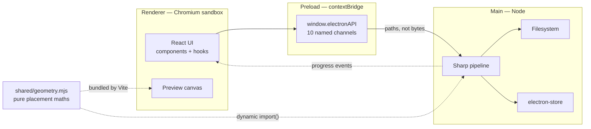
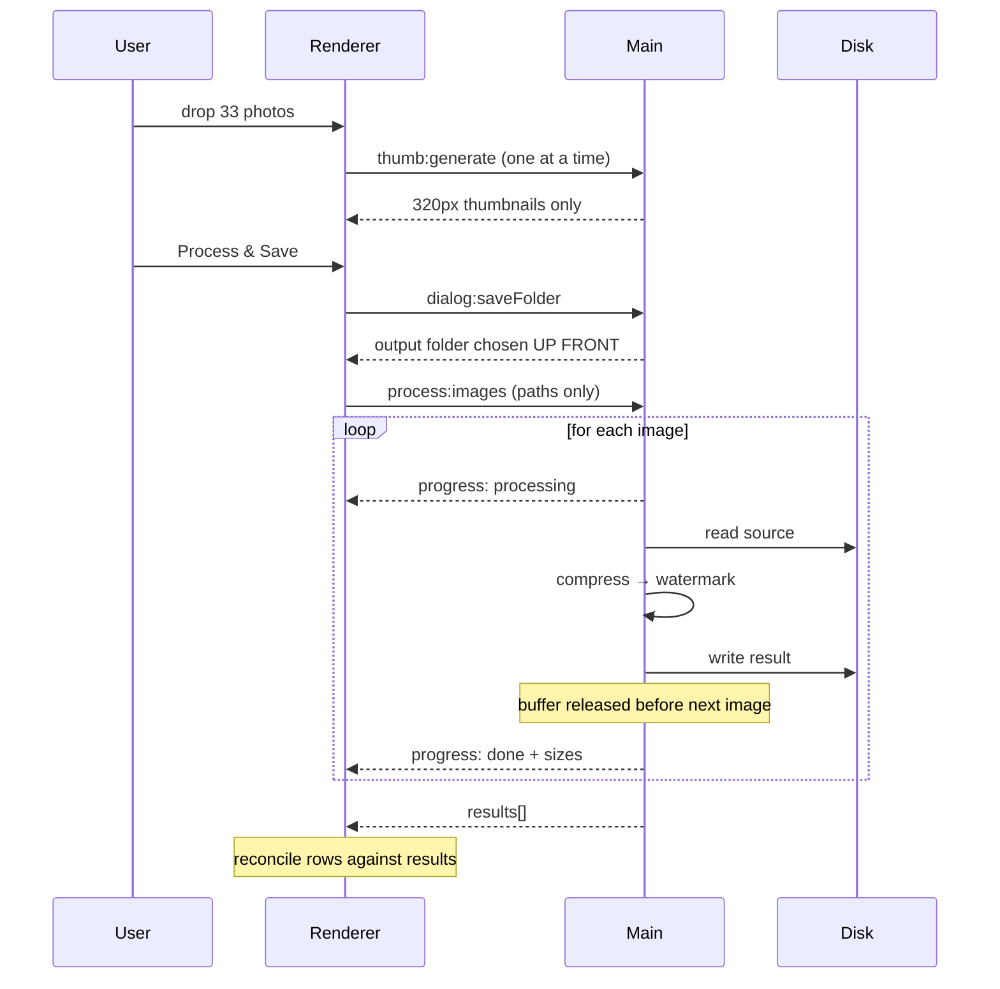

# Architecture

How Wehost Image Tool is put together, and why. For what the app _does_, see the [README](README.md).

## Process model

Electron gives you two processes with very different privileges. The split here is deliberate: the renderer is treated as untrusted and never gets access to the filesystem, Node, or full-resolution image data.



`shared/geometry.mjs` is the only module loaded by both sides. That is the point of it — see [Placement geometry](#placement-geometry).

## The IPC contract

Every channel is explicitly named and wrapped in [`electron/preload.js`](electron/preload.js). There is no generic passthrough, so the renderer cannot invoke anything the bridge does not list.

| Channel             | Direction       | Payload                                   | Returns                           | Notes                                                        |
| ------------------- | --------------- | ----------------------------------------- | --------------------------------- | ------------------------------------------------------------ |
| `process:images`    | renderer → main | `{files[], mode, settings, outputFolder}` | `{results[], outputFolder}`       | Files are `{name, size, path}` — **paths only, never bytes** |
| `process:progress`  | main → renderer | `{index, total, status, sizes, error}`    | —                                 | Emitted twice per image: `processing`, then `done`/`error`   |
| `thumb:generate`    | renderer → main | `{filePath}`                              | `{base64}`                        | 320px JPEG for the grid                                      |
| `preview:generate`  | renderer → main | `{filePath, maxWidth}`                    | `{base64, origWidth, origHeight}` | 1600px-capped render for the preview modal                   |
| `dialog:saveFolder` | renderer → main | —                                         | `{folderPath \| null}`            | Native picker, shown _before_ processing starts              |
| `shell:openFolder`  | renderer → main | `{folderPath}`                            | `{ok}`                            | Reveals results in Explorer                                  |
| `store:get`         | renderer → main | `{key}`                                   | `{value}`                         | electron-store                                               |
| `store:set`         | renderer → main | `{key, value}`                            | `{ok}`                            | electron-store                                               |
| `logo:save`         | renderer → main | `{base64}`                                | `{savedPath}`                     | Written to `userData/watermark.png`                          |
| `logo:read`         | renderer → main | —                                         | `{base64 \| null}`                | For the sidebar thumbnail and preview canvas                 |

The logo is the one image that _does_ cross IPC as base64. That is a deliberate exception: it is a small PNG, loaded once, and the preview canvas needs its actual pixels to draw with.

## The processing pipeline

The controlling constraint is that memory must not grow with batch size. A batch of 33 × 22 MB photos once exhausted RAM on the original design, which held every result in the renderer until the user picked a save location.



Three properties follow from this shape:

1. **One image in memory at a time.** The intermediate `buffer` is written and set to `null` before the loop advances.
2. **Partial batches are still useful.** Results exist on disk as they complete, so a crash or a quit halfway through leaves the finished images saved.
3. **Errors are per-image.** One unreadable file marks its own row failed and the batch continues.

### Why the renderer reconciles against the returned results

Progress events (`webContents.send`) and the `invoke` reply travel on **separate IPC channels with no ordering guarantee**. On a batch that fails fast — watermark mode with no logo set, where each image throws immediately — the reply can arrive first. The renderer's `finally` block then removes the progress listener before the per-image events land, and every row would sit on "Queued" with the reason never displayed.

So [`useProcessor.js`](src/hooks/useProcessor.js) treats the returned `results[]` as authoritative and folds it into the row state after the invoke resolves. Progress events drive the _live_ UI; the reply guarantees the _final_ state. This is covered by an E2E regression test.

## Placement geometry

`tileGap`, logo size and position are authored against the **original image's pixel dimensions**, because that is the coordinate space the preview modal displays. Everything downstream converts _into_ its own space rather than redefining the convention.

| Context               | Canvas size                     | Conversion                                   |
| --------------------- | ------------------------------- | -------------------------------------------- |
| Preview modal         | 1600px-capped render            | `scaleGap(gap, previewWidth, originalWidth)` |
| Watermark-only output | original size                   | none — already in original space             |
| "Both" mode output    | resized by the compression step | `scaleGap(gap, resizedWidth, originalWidth)` |

Two rules the pipeline and the preview must agree on:

- **Tiling steps by the logo's pre-rotation size.** A rotated logo has a larger bounding box; stepping by that would space tiles unevenly as the angle changes. The rotated bitmap is instead centred inside a slot sized by the original. Tiles overhanging the right and bottom edges are intentional — Sharp clips composites that extend past the canvas rather than throwing (verified empirically), and the overhang is what makes tiling reach the edge instead of stopping short.
- **Single placements are inset by 2% of image width.** Sharp's `gravity` option pins overlays _flush_ to the edge, which is not what the preview draws — so the pipeline computes explicit `top`/`left` offsets instead of using gravity at all.

Both rules live in [`shared/geometry.mjs`](shared/geometry.mjs) as pure functions. That module is ESM so Vite can bundle it into the renderer; the CommonJS main process loads it once during `app.whenReady()` via dynamic `import()`, before any window exists. Because it is pure — no Sharp, no DOM, no Electron — it is unit-testable directly, and [`tests/unit/geometry.test.mjs`](tests/unit/geometry.test.mjs) is where the behaviour is pinned down.

## Security model

| Control                       | Where                                        |
| ----------------------------- | -------------------------------------------- |
| `contextIsolation: true`      | [`electron/main.js`](electron/main.js)       |
| `nodeIntegration: false`      | [`electron/main.js`](electron/main.js)       |
| Strict CSP, no remote origins | [`index.html`](index.html)                   |
| Explicit channel allowlist    | [`electron/preload.js`](electron/preload.js) |
| No network code at all        | whole app                                    |

The renderer never receives a filesystem handle. `webUtils.getPathForFile` runs in the _preload_, converting a dropped `File` into a path string; the renderer only ever holds that string, and the main process is what opens it.

## State

[`electron-store`](https://github.com/sindresorhus/electron-store) persists settings as JSON in `userData`:

```jsonc
{
  "logoPath": "…/userData/watermark.png",
  "watermark": {
    "position": "southeast",
    "tiled": false,
    "tileGap": 150,
    "opacity": 0.7,
    "sizePercent": 0.12,
    "rotation": 0
  },
  "compress": { "format": "jpeg", "quality": 82, "resizeEnabled": true, "maxWidth": 2400 },
  "lastMode": "both"
}
```

electron-store v8 is CommonJS and is required directly; v9+ is ESM-only and would need the same dynamic-import treatment as the geometry module.

## Testing strategy

Two layers, deliberately unbalanced.

**Unit tests** (`node:test`, no dependencies) cover the placement geometry exhaustively, because it is pure, it is where the real bugs were, and it is cheap to test at that level.

**E2E tests** (Playwright `_electron`) cover everything else by driving the actual application — real window, real IPC, real Sharp, real files on disk. There is no mocked middle layer, because the bugs that mattered in this project lived precisely in the seams a mock would paper over.

Two details make the E2E layer honest:

- `NODE_ENV=production` flips `isDev` in main.js so the app loads its built bundle from `dist/`, the same path a packaged build takes — rather than the Vite dev server.
- Each launch gets a fresh `--user-data-dir`, so tests never read or overwrite the developer's real settings and logo.

Only the native folder picker is stubbed, because a modal OS dialog cannot be driven headlessly.
