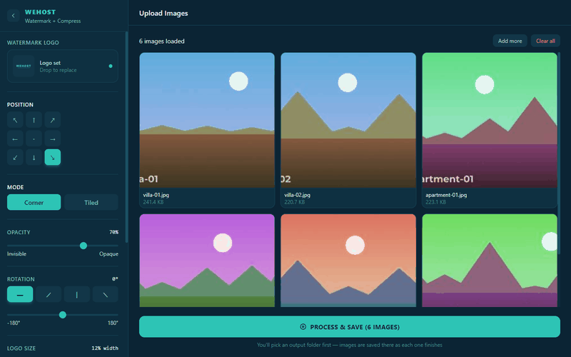
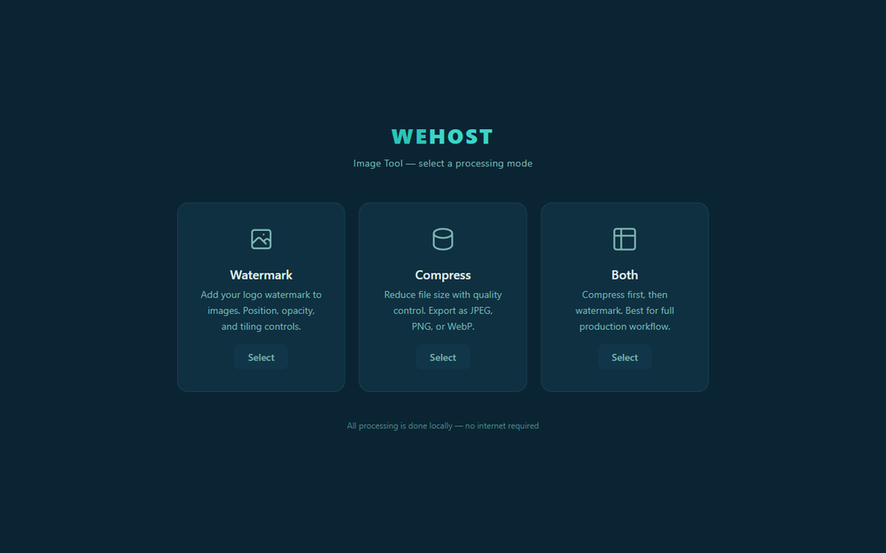
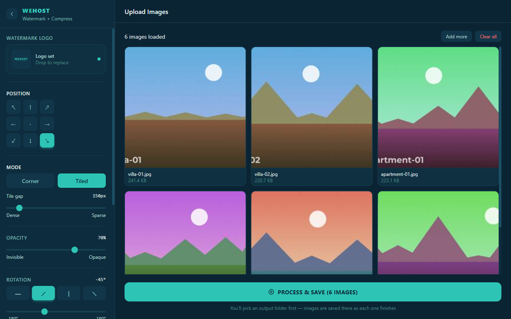
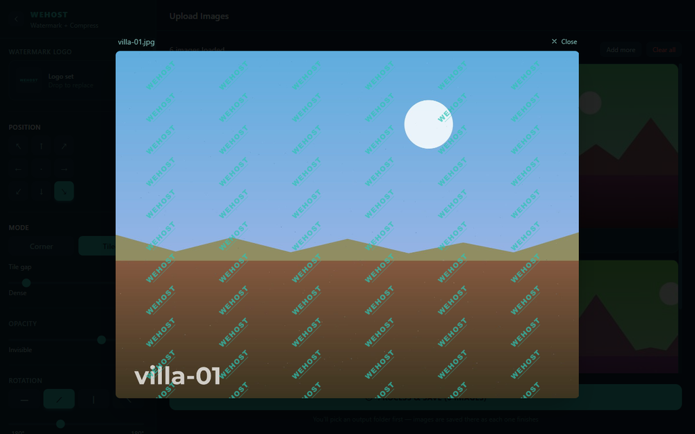
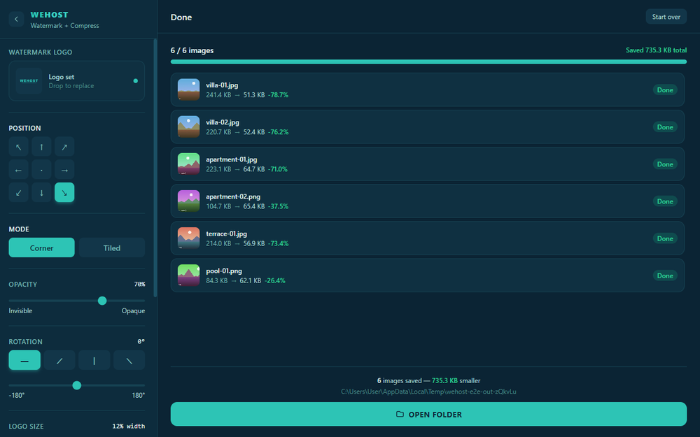

<div align="center">

# Wehost Image Tool

**A Windows desktop app that watermarks and compresses hundreds of photos at once — entirely offline.**

[](https://github.com/nikoGogiberidze/wehost-image-tool/actions/workflows/ci.yml)
[](LICENSE)
[](https://electronjs.org)
[](https://react.dev)
[](https://sharp.pixelplumbing.com)
[](#download)



</div>

## The problem

A hosting company's marketing team had a recurring, tedious job: every property shoot came back as a folder of 20–40 full-resolution photos, and every one of them needed the company logo applied and the file size cut down before it could go on the site.

The existing options were all bad in the same way. Online batch tools mean uploading a client's unpublished property photos to a stranger's server. Photoshop actions mean owning Photoshop and knowing how to script it. Desktop freeware means an installer roulette of bundled toolbars.

So this is the boring, specific tool that does that one job: drop in a folder of photos, pick a logo, get watermarked and compressed images out — with **nothing leaving the machine**. No account, no upload, no network calls at all.

In the demo above, six images go from 1.09 MB down to 353 KB — a **68% reduction** — while being watermarked, in a single pass.

## Features

|                                                                |                                                                                                                                                                                    |
| -------------------------------------------------------------- | ---------------------------------------------------------------------------------------------------------------------------------------------------------------------------------- |
|          | **Three modes.** Watermark only, compress only, or both in a single pass. In "both" the image is compressed first and watermarked second, so the logo never gets re-encoded twice. |
|  | **Drag in a whole folder.** Thumbnails are generated by Sharp in the background, one at a time, so a 40-image batch doesn't spike memory or freeze the grid.                       |
|         | **Full watermark control.** Nine anchor positions or edge-to-edge tiling, with opacity, rotation, logo size and tile spacing.                                                      |
|      | **Preview before you commit.** Renders your exact settings on a real image, using the _same placement code_ the output pipeline runs.                                              |
|  | **Per-image results.** Live progress with before/after sizes and the percentage saved, then one click to open the output folder.                                                   |

Supported in: JPEG, PNG, WebP · Supported out: JPEG, PNG, WebP

## Download

Grab the installer from the [latest release](https://github.com/nikoGogiberidze/wehost-image-tool/releases/latest) and run it.

> **A note on the SmartScreen warning.** The installer is not code-signed — a signing certificate costs a few hundred dollars a year, which is hard to justify for a free tool. Windows will show a "Windows protected your PC" dialog; click **More info → Run anyway**. If you'd rather not take my word for it, the [build workflow](.github/workflows/release.yml) compiles the release from this source on GitHub's runners, so you can check the binary against the code that produced it — or just build it yourself below.

## Build from source

Requires [Node.js](https://nodejs.org) 20 or newer.

```bash
git clone https://github.com/nikoGogiberidze/wehost-image-tool.git
```

```bash
cd wehost-image-tool && npm install
```

```bash
npm run dev
```

`npm run dev` starts Vite and Electron together with hot reload. To produce an installer in `release/`:

```bash
npm run dist
```

<details>
<summary><strong>All available scripts</strong></summary>

| Script                | What it does                                                 |
| --------------------- | ------------------------------------------------------------ |
| `npm run dev`         | Vite dev server + Electron, hot reload                       |
| `npm run build`       | Build the renderer bundle into `dist/`                       |
| `npm run dist`        | Build + package a Windows NSIS installer into `release/`     |
| `npm test`            | Unit tests for the placement geometry (`node:test`, no deps) |
| `npm run test:e2e`    | Playwright tests that drive the real Electron app end to end |
| `npm run lint`        | ESLint                                                       |
| `npm run format`      | Prettier                                                     |
| `npm run fixtures`    | Generate the sample photos the tests and screenshots use     |
| `npm run screenshots` | Re-capture every image in this README from the live app      |
| `npm run icon`        | Regenerate the app icon from its source SVG                  |

</details>

## Engineering notes

The interesting parts of this project were not the image filters — Sharp does that. They were memory, and keeping two renderers of the same geometry in agreement.

### The batch that took down the machine

The first version passed images to the main process as base64 over IPC and held every result in renderer memory until the user chose where to save. It worked fine on the ten-image batches used while building it.

Then a real batch arrived: 33 photos at ~22 MB each. Base64 inflates binary by a third, every copy crossed the IPC boundary as a string, and nothing was released until the very end. It exhausted RAM and took the whole machine down with it.

The redesign inverted the data flow:

- **Files never enter the renderer.** Dropped files are resolved to disk paths via `webUtils.getPathForFile` in the preload, and only the path, name and size cross IPC.
- **The output folder is chosen up front**, before any work starts.
- **Each result is written and released as it finishes** ([`main.js`](electron/main.js)), so exactly one image is ever in memory.
- **The renderer only ever holds 320px thumbnails.** The preview modal fetches a separate 1600px-capped render on demand; full-resolution pixels never reach the UI process at all.

Memory is now flat with respect to batch size — 33 × 22 MB uses the same working set as 5 × 2 MB. Two Sharp settings matter here too: `sharp.cache(false)` stops libvips holding decoded images between files, and `sharp.concurrency(cores - 2)` leaves the UI enough CPU to stay responsive while a batch runs.

### Two copies of the same maths will drift

The watermark preview draws on a `<canvas>` in the renderer; the real output is composited by Sharp in the main process. They started as separate implementations of the same layout, and they diverged twice:

**The tile gap was in the wrong coordinate space.** `tileGap` is defined in _original-image_ pixels, because that is what the preview shows. But in "both" mode the image is resized during compression before it is watermarked — so a 150px gap authored against a 4000px original became a 150px gap on a 1600px image, and the output came out with a handful of tiles where the preview had promised twenty.

**Corner placement disagreed silently.** The pipeline used Sharp's `gravity: 'southeast'`, which pins the overlay _flush_ against the edge. The preview inset it by 2% of the image width. Every corner watermark landed somewhere the preview never showed — which I only found while writing the regression tests for this repo.

The fix for both was to stop having two copies. [`shared/geometry.mjs`](shared/geometry.mjs) is pure arithmetic — no Sharp, no DOM — imported by _both_ the Sharp pipeline and the canvas preview. It is ESM so Vite can bundle it into the renderer, and the CommonJS main process loads it once at startup via dynamic `import()`. Being pure, it is also directly unit-testable, which is where most of the test suite lives.

### Security posture

It's a desktop app that reads arbitrary user files, so the renderer is treated as untrusted:

- `contextIsolation: true` and `nodeIntegration: false`
- A strict `Content-Security-Policy` in [`index.html`](index.html) with no remote origins permitted
- A deliberately narrow [`contextBridge`](electron/preload.js) surface — ten named channels, no general-purpose `ipcRenderer.invoke` passthrough
- No network code anywhere in the app; it works with the machine offline

## Architecture

```
┌─────────────────────────────┐         ┌──────────────────────────────┐
│  Renderer (React + Vite)    │         │  Main process (Node)         │
│                             │  IPC    │                              │
│  • UI, settings, previews   │◄───────►│  • Sharp pipeline            │
│  • holds paths + thumbnails │  paths  │  • electron-store settings   │
│    only, never full images  │  only   │  • writes results to disk    │
└─────────────────────────────┘         └──────────────────────────────┘
                    ▲                                ▲
                    └────────┬───────────────────────┘
                    shared/geometry.mjs
              (one implementation of placement)
```

```
electron/     main process — Sharp pipeline, IPC handlers, preload bridge
shared/       placement geometry imported by BOTH processes
src/          React renderer — components, hooks, IPC wrappers
tests/        unit tests (node:test) + Playwright E2E against the real app
scripts/      fixture, icon and screenshot generation
```

[**ARCHITECTURE.md**](ARCHITECTURE.md) has the full IPC contract, the processing sequence, and the placement conventions.

## Tests

```bash
npm test && npm run test:e2e
```

**22 unit tests** cover the placement geometry — tile grids, rotation centring, the gap rescale, filename/extension rules, and the degenerate inputs that could otherwise loop forever.

**7 end-to-end tests** launch the actual Electron application, load real images through the real drop zone, run the real Sharp pipeline, and assert on the files that land on disk: that outputs shrink, that dimensions are preserved in watermark-only mode, that the max-width cap is honoured, that watermarked pixels actually changed, that corner watermarks are inset rather than flush, and that a missing logo surfaces a readable error instead of failing silently.

They are not mocked. `NODE_ENV=production` makes the app load its built bundle exactly as a packaged build does, the native folder picker is stubbed, and each run gets a throwaway `userData` directory so tests can't touch your real settings.

## Limitations and roadmap

- **Windows only** at present. The code has no Windows-specific logic and Sharp and Electron both support macOS and Linux, but the build is only produced and tested for Windows — the other targets are untried, so I'd rather not claim them.
- **The installer is unsigned** (see [Download](#download)).
- Settings are global rather than per-preset; saved watermark presets would be the obvious next feature.
- No CLI. Everything goes through the GUI.

## License

[MIT](LICENSE) © Niko Gogiberidze

The Wehost name and wordmark belong to Wehost; they appear here because this tool was built for them, and are not covered by the MIT grant.
